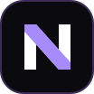

<div align="center">



# Nexo

**Suas ideias encontram lugar.**

Notas, quadros e conhecimento conectado em um espaço local, em português.

[Começar](#como-executar) · [Recursos](#recursos) · [Documentação](#documentação) · [Contribuir](#como-contribuir)

</div>

## Sobre o projeto

O **Nexo**, hospedado neste repositório **NotionOS**, é uma versão personalizada do AFFiNE para escrever, organizar referências e desenvolver ideias em quadros visuais. A experiência combina um editor de documentos com uma tela livre para conectar conteúdos.

Esta versão prioriza o uso local no navegador: sem cadastro, IA, sincronização em nuvem, colaboração online ou assinaturas. Novos perfis começam em português brasileiro, com tema escuro por padrão e opção de tema claro.

> **Estado atual:** aplicativo web para execução local. Este repositório não fornece um instalador desktop próprio. Parte da estrutura herdada contém outros aplicativos e serviços que não fazem parte do escopo local do Nexo.

## Recursos

| Recurso                     | O que você pode fazer                                                    |
| --------------------------- | ------------------------------------------------------------------------ |
| **Documentos**              | Criar e editar notas com o editor de blocos do BlockSuite.               |
| **Quadros visuais**         | Organizar ideias em uma tela livre, alternando entre documento e quadro. |
| **Organização**             | Usar coleções, tags, modelos e busca para encontrar seus conteúdos.      |
| **Importação e exportação** | Trazer documentos e exportar conteúdos ou backups.                       |
| **Personalização**          | Alternar entre temas claro e escuro e ajustar o idioma.                  |
| **Armazenamento local**     | Manter notas e quadros no navegador, sem precisar de uma conta.          |

## Como executar

### Pré-requisitos

- **Git** para clonar o repositório.
- **Node.js 22**, na faixa `>=22.12.0 <23.0.0`. A versão fixada em [`.nvmrc`](.nvmrc) é `22.23.4`.
- **Yarn 4.18.0**, incluído em `.yarn/releases/` e configurado em `package.json`.
- **Rust via rustup** para compilar os módulos nativos. A versão é definida em [`rust-toolchain.toml`](rust-toolchain.toml).
- Ferramentas de compilação nativa do seu sistema; no Windows, pode ser necessário instalar o Visual Studio Build Tools com a carga de trabalho C++.

No Windows, habilite o **Modo de Desenvolvedor** para permitir a criação de links simbólicos.

### 1. Clonar

```sh
git clone -c core.symlinks=true https://github.com/RafaelADSdev/NotionOS.git
cd NotionOS
```

### 2. Instalar e preparar

Com Node 22 ativo no terminal:

```sh
node .yarn/releases/yarn-4.18.0.cjs install --immutable
node .yarn/releases/yarn-4.18.0.cjs affine init
node .yarn/releases/yarn-4.18.0.cjs affine @affine/native build
```

A inicialização é explícita porque a configuração do Yarn desativa a execução automática de scripts de instalação.

### 3. Iniciar

```sh
node .yarn/releases/yarn-4.18.0.cjs dev -p @affine/web
```

Depois da compilação, abra o endereço **Local** exibido no terminal, normalmente [http://localhost:8080](http://localhost:8080). Mantenha o terminal aberto enquanto usa o aplicativo.

**Atalho no Windows:** depois de preparar as dependências, abra `iniciar-nexo.cmd` ou execute no PowerShell:

```powershell
.\iniciar-nexo.cmd
```

O inicializador procura primeiro o Node portátil em `%LOCALAPPDATA%/Nexo/tools/node-v22.23.4-win-x64/`; se ele não existir, usa o Node disponível no `PATH`. Ele verifica a versão 22, mas não instala Node nem dependências.

Não é necessário iniciar os serviços de backend para usar notas e quadros locais.

## Seus dados e backups

Os documentos ficam no armazenamento do navegador, vinculados ao perfil e à origem em que o aplicativo foi aberto. Limpar os dados do site, trocar de perfil, navegador ou porta pode fazer seus documentos deixarem de aparecer naquele endereço.

- Exporte backups regularmente e guarde uma cópia fora do navegador.
- Antes de limpar dados do site ou mudar de ambiente, exporte seus conteúdos.
- Para recuperar uma cópia, use a importação disponível no aplicativo.

**Armazenamento local não substitui backup.** Esta versão não mantém uma cópia automática em nuvem. Imagens externas também podem depender de conexão e das permissões do site de origem.

## Tecnologias e estrutura

O projeto mantém o monorepo do AFFiNE, com **TypeScript**, **React**, **BlockSuite**, **Yarn Workspaces** e módulos nativos em **Rust**. Os identificadores internos `@affine/*` e os formatos de documentos são preservados para manter compatibilidade.

```text
NotionOS/
├── blocksuite/                 # Editor de blocos e quadros
├── packages/
│   ├── frontend/
│   │   ├── apps/web/           # Entrada do aplicativo web
│   │   ├── core/              # Interface e funcionalidades principais
│   │   └── native/            # Módulos nativos do cliente
│   └── backend/               # Serviços herdados do projeto original
├── scripts/nexo/              # Inicializador local do Nexo
├── tests/                     # Suítes de testes
├── tools/                     # Ferramentas do monorepo
├── docs/                      # Guias técnicos e identidade visual
├── PRODUCT.md                 # Escopo da personalização
└── iniciar-nexo.cmd            # Atalho de execução no Windows
```

## Desenvolvimento

Use o Yarn incluído no repositório para executar os comandos:

| Comando                                                  | Finalidade                                   |
| -------------------------------------------------------- | -------------------------------------------- |
| `node .yarn/releases/yarn-4.18.0.cjs dev -p @affine/web` | Iniciar o aplicativo web em desenvolvimento. |
| `node .yarn/releases/yarn-4.18.0.cjs lint`               | Verificar lint e formatação.                 |
| `node .yarn/releases/yarn-4.18.0.cjs typecheck`          | Verificar tipos TypeScript.                  |
| `node .yarn/releases/yarn-4.18.0.cjs test`               | Executar testes com Vitest.                  |

O monorepo também contém testes de integrações de nuvem e outros clientes. Essas suítes podem exigir serviços adicionais; sua presença não significa que esses recursos estejam habilitados no Nexo.

### Problemas comuns

- **Versão de Node incompatível:** ative o Node 22 antes de instalar ou iniciar. Confira com `node --version`.
- **Dependências ausentes no inicializador:** execute as etapas de instalação e preparação acima.
- **Erro de link simbólico no Windows:** habilite o Modo de Desenvolvedor antes de clonar e instalar.
- **Falha em módulo nativo:** confirme que Rust e as ferramentas de compilação estão disponíveis; depois execute novamente o build de `@affine/native`.
- **Porta ocupada:** use o endereço informado pelo terminal. Se mudar a porta, a origem do armazenamento local também muda.

## Documentação

- [Escopo do produto](PRODUCT.md): comportamento e limites desta personalização.
- [Instalação e desenvolvimento](docs/BUILDING.md): instruções do Nexo e referência técnica herdada.
- [Identidade visual](docs/brand/DESIGN.md): referências de design do Nexo.

Os guias herdados podem descrever contas, IA, nuvem e distribuições do AFFiNE original. Para o comportamento desta versão, consulte o escopo do Nexo em `PRODUCT.md`.

## Como contribuir

Abra uma [issue](https://github.com/RafaelADSdev/NotionOS/issues) com uma descrição do problema ou da proposta. Para correções, inclua passos para reproduzir, sistema operacional e versão do Node; para mudanças de interface, imagens ajudam.

Ao enviar um pull request, mantenha o foco da alteração, execute as verificações pertinentes e preserve a compatibilidade dos documentos, as licenças e o escopo local do aplicativo. Não inclua backups pessoais, credenciais ou arquivos `.env`.

## Origem e licenças

O Nexo deriva de **AFFiNE** e **BlockSuite**, desenvolvidos pela **Toeverything e seus contribuidores**. Esta personalização preserva as atribuições e licenças originais.

- [LICENSE](LICENSE) descreve a distribuição das licenças por diretório.
- [LICENSE-MIT](LICENSE-MIT) contém a licença MIT aplicável às partes indicadas.
- O backend e os demais componentes de terceiros seguem suas respectivas licenças, conforme indicado nos arquivos correspondentes.

Consulte as licenças dos componentes antes de redistribuir o projeto.
